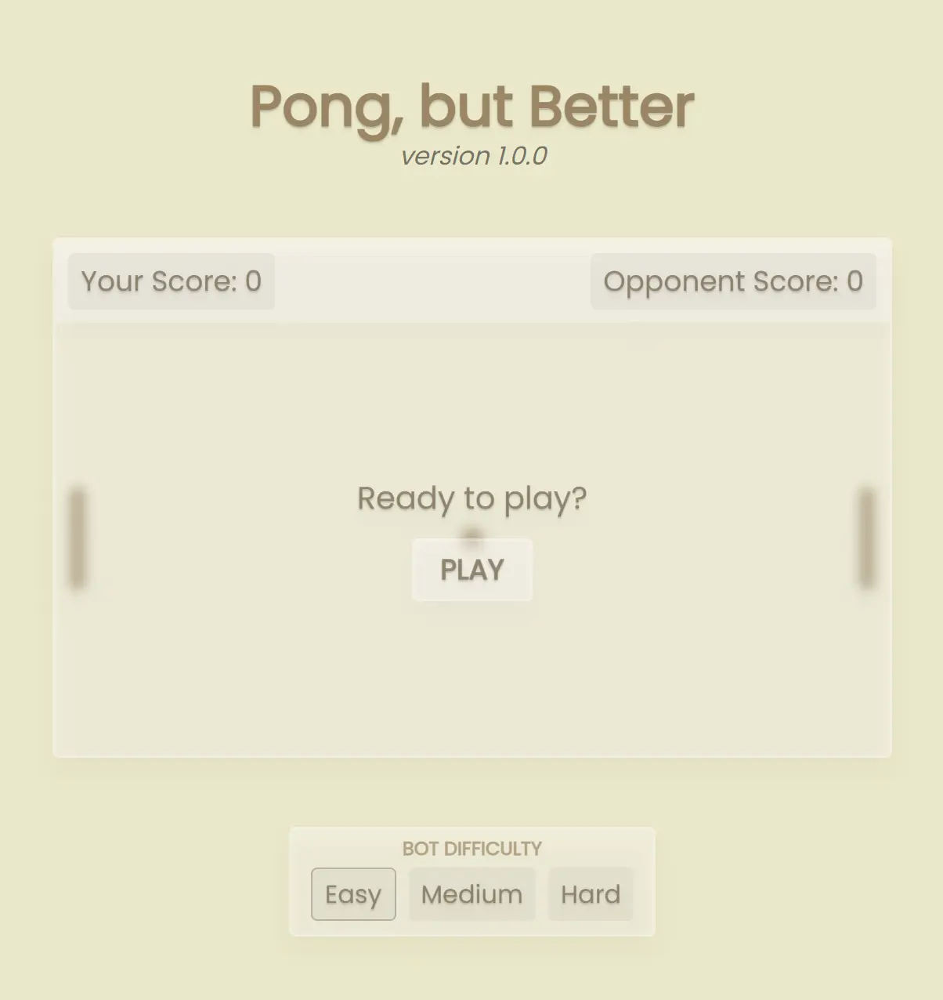

	<h3 style="font-size: 30px">Pong, but Better</h3>
	<a href="pongbutbetter.com">
		<picture>
			<source media="(prefers-color-scheme: dark)" alt="Pong, but better logo" width="150" srcset="img/logo-dark.svg">
			<source media="(prefers-color-scheme: light)" alt="Pong, but better logo" width="150" srcset="img/logo-light.svg">
			
		</picture>
		 
		<h3><strong><u>Try it out</u></strong></h3>
	</a>

## What is it?

Pong, but Better is a showcase of an experimental game engine made from scratch. Using modern technologies such as WebAssembly and Web Workers, this aims to outperform legacy web game engines in both ease-of-use and raw performance. Currently, it is an early prototype and is only meant as a development showcase.

## Structure
The game engine is made in two seperate parts: the Typescript side and the WASM/Rust side. 

|Property|WASM|Typescript|
|-|-|-|
|Thread| Worker thread | Main thread |
|Entity Access| ECS World | ``SharedArrayBuffer`` via EntityTracker and commands
|Roles|Collisions, movement, rendering|Match starting/stopping, UI updates, inputs

**These two sides created a "language barrier" that made communication difficult**, so here's what I did to make it easier:

### Typescript to WASM (WebAssembly) Communication

The general pattern for allowing the Typescript side to communicate with the WASM side is to read from a buffer containing information at some specific step in the game loop. This allows for the commands to safely and easily mutate the world without interrupting performance, but information is recieved purely at the leisure of the game loop.

#### Command Buffer

The WASM side listens for messages with the Web Worker API. If the message is a command (sent using ``middleman.rs``), it'll deserialize the command and add it to the command buffer. Commands within the command buffer are then read at a certain point in the game loop and propogated to the appropriate resources. 

#### Shared Array Buffer (Entity Tracker)

First, special entities are created on the Typescript side by sending a message to the WASM side to allocate a certain portion of the buffer to the special entity. This buffer slice will contain basic entity information such as position, velocity, and acceleration. The goal of this structure is to allow rapid changes in entities without sending a message via ``Worker.postMessage``, and to allow the Typescript side to view these basic properties of the tracked entities in a performant manner. 

At the start of every game loop, the WASM side will copy the entity data from the SAB (``SharedArrayBuffer``) into the actual entities stored in the ECS. At the end of the game loop, the WASM side will update the entity data within the SAB to reflect the new entity data from the ECS. It will only perform this "update" step if a certain byte at the beginning of the ``SharedArrayBuffer`` is 0. This byte is just a "lock" that will delay the update to the next frame if there were changes made by the Typescript side while the entities were being updated by the WASM side.

### Rendering

Rendering is done using ``lyon`` to tessellate the geometry into vertices and ``wgpu`` to draw those vertices on an ``OffscreenCanvas``. It's done on the worker thread to make sharing the vertex and index buffers easy. I plan on also only tessellating the geometry before each frame, but this is relatively low-priority relative to other changes I can make.

## Results

- The game loop can run at most 3000 times per second before being limited by Javascript's macrotask scheduling and garbage collector runs. The loop itself usually takes around 25 microseconds on my 9800x3D. I've tested it running at 3000 times per second on weaker hardware (entry-level laptops) and it doesn't slow down or strain the CPU.
- **TODO** Benchmark the amount of moving and colliding entities compared to the performance of the game.

## Technologies

### Used

- One
- Two

### Planned